# Mapa visual do programa

Diagramas de todos os componentes do OBD2 Scanner, em linguagem simples. O GitHub desenha os diagramas sozinho ao abrir este arquivo no site (eles são escritos em [Mermaid](https://mermaid.js.org), um formato de texto para diagramas). No VS Code, instale a extensão **Markdown Preview Mermaid Support** e use `Ctrl+Shift+V` para ver.

> **Regra do projeto:** quem mudar, criar ou remover um componente atualiza este arquivo no mesmo commit.

Sumário: [1. Visão geral](#1-visão-geral) · [2. Do carro até a tela](#2-do-carro-até-a-tela) · [3. Formas de conectar](#3-formas-de-conectar) · [4. Motor (obd-core)](#4-motor-obd-core) · [5. Saúde da conexão](#5-saúde-da-conexão-travamento-e-reconexão) · [6. Telas e módulos da interface](#6-telas-e-módulos-da-interface) · [7. Perfis e unidades](#7-perfis-de-veículos-e-unidades) · [8. Onde os dados ficam guardados](#8-onde-os-dados-ficam-guardados) · [9. Verificação automática (CI)](#9-verificação-automática-ci)

---

## 1. Visão geral

O programa tem três andares. Embaixo, o **motor** (Rust) sabe conversar com o adaptador e entender as respostas do carro. No meio, a **casca** (Tauri) transforma o motor num programa de Windows e leva as mensagens entre os andares. Em cima, a **interface** (as telas) mostra tudo para você.

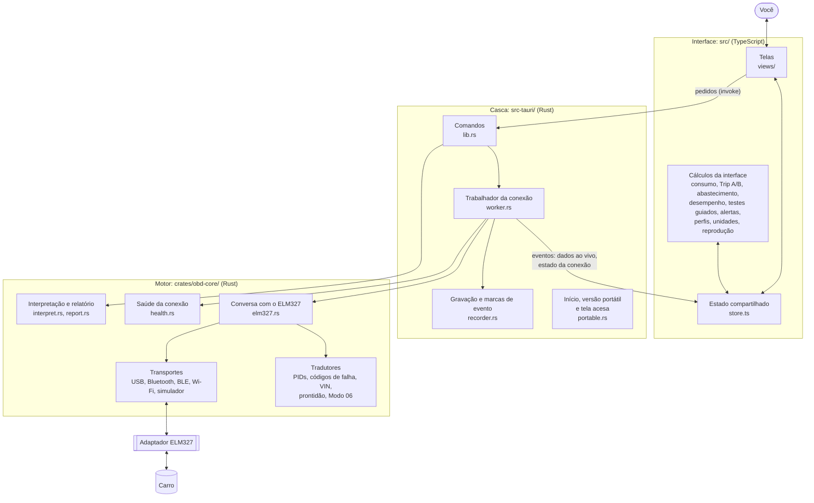

---

## 2. Do carro até a tela

Caminho de **um valor ao vivo** (por exemplo, a rotação do motor), várias vezes por segundo.

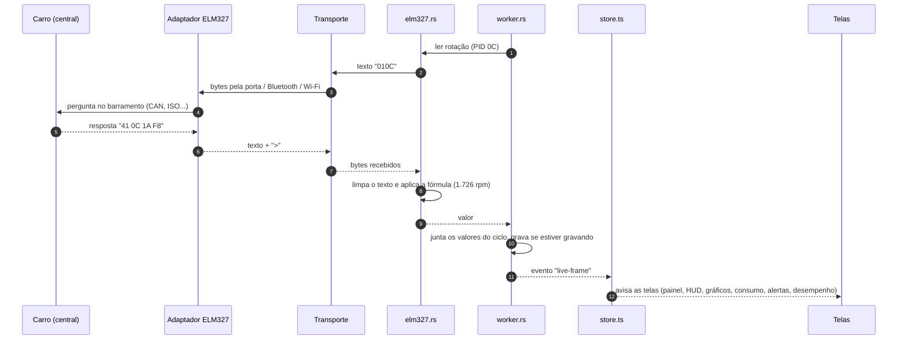

---

## 3. Formas de conectar

Todas as conexões seguem a mesma regra (a interface `Transport`): só levar bytes de um lado para o outro. Por isso o resto do programa não precisa saber qual está em uso.

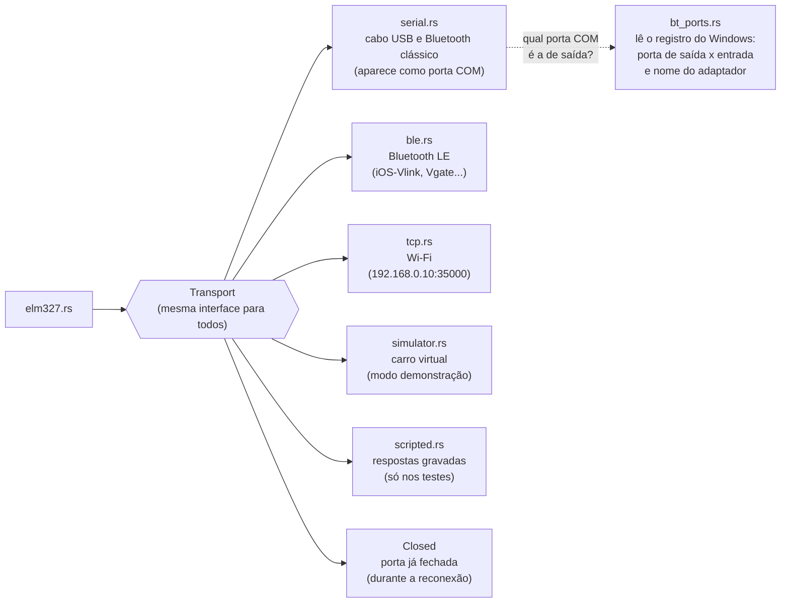

---

## 4. Motor (obd-core)

O motor não tem telas. Ele pode ser testado sozinho (`cargo test`) e reaproveitado em outro programa.

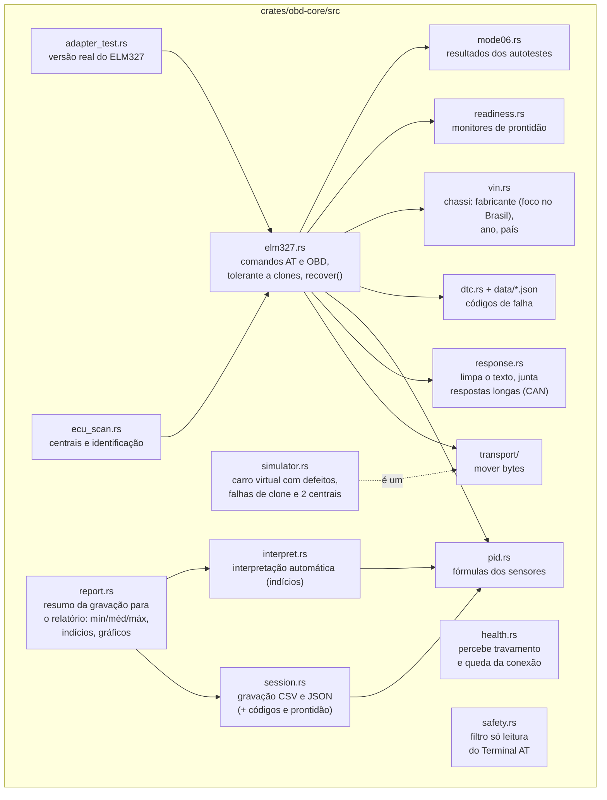

### Ferramentas de diagnóstico do adaptador e do carro

Os dois testes mudam configurações do adaptador por alguns segundos e sempre terminam com um reinício (`ATZ`) e a configuração de volta. Nenhum deles grava nada no adaptador nem na central do carro.

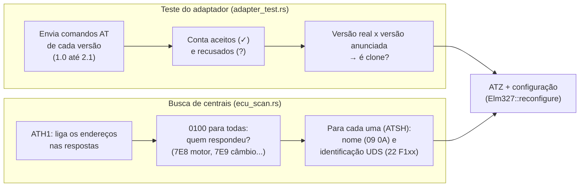

### Só leitura: o que nunca sai do programa

O programa só lê o carro. O Terminal AT é o único lugar onde se digita um comando livre, então cada linha passa por `safety.rs` antes de ir ao adaptador, e vai exatamente como foi conferida: sem espaços, quebras de linha ou caracteres invisíveis, para que uma linha nunca leve um segundo comando escondido. Apagar códigos tem botão próprio, que pede confirmação e confere na hora se o motor está parado.

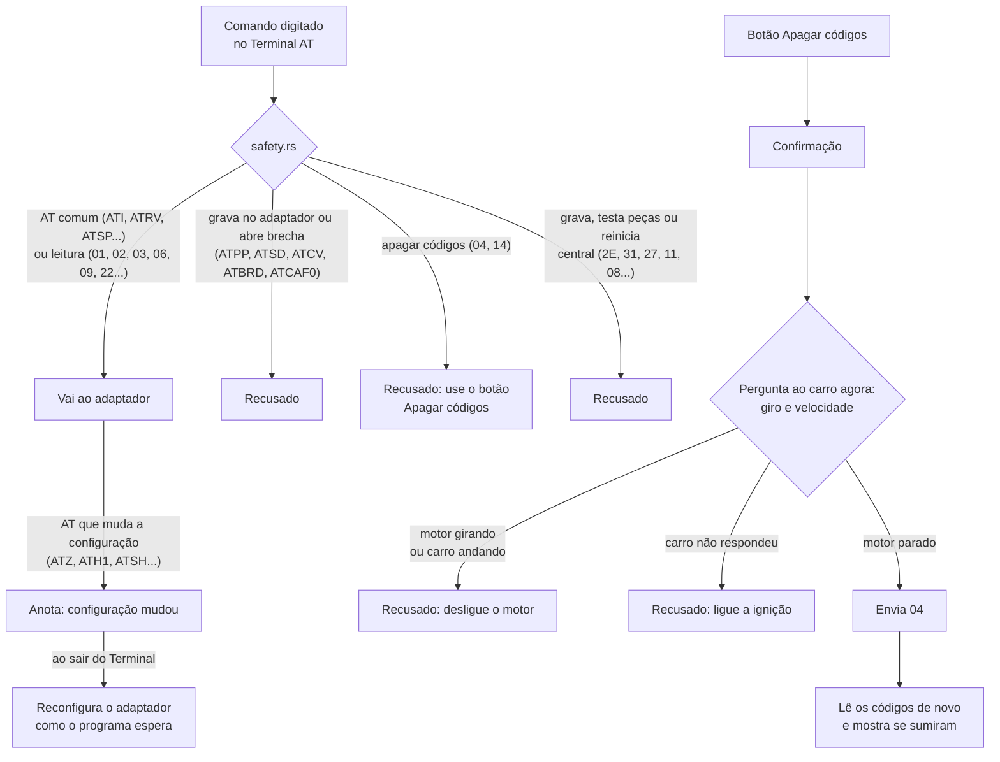

Comandos como `ATZ` (reiniciar) ou `ATH1` (mostrar cabeçalhos) mudam o jeito como o adaptador responde, e o painel ao vivo não entenderia as respostas. Por isso, ao sair do Terminal, o programa reconfigura o adaptador do mesmo jeito que faz depois de uma reconexão, no protocolo já encontrado e sem busca lenta.

---

## 5. Saúde da conexão: travamento e reconexão

Adaptadores clones às vezes travam, reiniciam sozinhos numa queda de tensão (na partida do motor) ou perdem o Bluetooth. O trabalhador da conexão (`worker.rs`) observa cada resposta com a ajuda de `health.rs` e reage sozinho. A tela mostra uma faixa amarela enquanto isso acontece.

```mermaid
stateDiagram-v2
    [*] --> Normal
    Normal --> Normal: resposta válida ou "NO DATA"
    Normal --> Suspeito: silêncio, STOPPED,<br/>BUFFER FULL, lixo
    Suspeito --> Normal: voltou a responder
    Suspeito --> Recuperando: 3 pedidos seguidos sem resposta
    Normal --> Recuperando: adaptador reiniciou sozinho<br/>(apareceu "ELM327 v..." ou "LV RESET")
    Recuperando --> Normal: ATI responde, ATZ + configuração,<br/>mesmo protocolo de antes
    Recuperando --> CarroCalado: adaptador ok,<br/>carro não responde
    CarroCalado --> Normal: tenta de novo em 5 s
    Recuperando --> Reconectando: adaptador não responde nem ao ATI
    Normal --> Reconectando: porta caiu<br/>(Bluetooth fora de alcance, cabo)
    Reconectando --> Normal: porta reaberta<br/>(espera 1, 2, 3, 5, 8, 10, 10... s;<br/>USB: também na COM nova)
    Reconectando --> Desconectado: 3 minutos sem sucesso<br/>ou você clicou em "Parar"
    Desconectado --> [*]
```

Se o adaptador for USB e o Windows mudar o número da COM depois de tirar e pôr o cabo, a reconexão encontra o mesmo adaptador na porta nova pelo número de série do USB.

Com o adaptador parado (sem leitura ao vivo), um `ATRV` silencioso a cada 10 s percebe a queda cedo. No modo demonstração dá para provocar cada falha (Conexão → "Simular falhas de adaptador clone").

---

## 6. Telas e módulos da interface

Cada tela é um arquivo em `src/views/`. Os módulos de cálculo ficam em `src/` e trabalham com os mesmos dados ao vivo, por isso funcionam igual com o carro e com uma gravação reproduzida.

```mermaid
flowchart LR
    subgraph telas["Telas (src/views/)"]
        connection["Conexão<br/>+ teste do adaptador"]
        dashboard["Painel ao vivo"]
        findings["Quadro Interpretação<br/>dos dados<br/>views/findings.ts"]
        refueldlg["Janela Abasteci<br/>views/refuel-dialog.ts"]
        safetydlg["Aviso de segurança<br/>ao abrir o programa<br/>views/safety.ts"]
        hud["HUD"]
        journey["Viagem<br/>Iniciar/Encerrar, análise<br/>de consumo, relatório<br/>views/journey.ts"]
        performance["Testes de desempenho<br/>(uma prova por vez)"]
        guided["Testes guiados<br/>bateria, sondas,<br/>mapa de correção"]
        charts["Gráficos"]
        diagnostics["Códigos de falha<br/>+ Modo 06"]
        vehicle["Veículo e prontidão<br/>+ centrais"]
        terminal["Terminal AT"]
        sessions["Gravações e relatórios"]
        glossary["Glossário"]
        docsview["Documentação<br/>guias, regras, diagramas,<br/>dados e licenças"]
        settings["Configurações"]
    end
    subgraph modulos["Módulos (src/)"]
        store["store.ts<br/>estado e avisos"]
        api["api.ts<br/>ponte com o Rust"]
        trip["trip.ts + trips.ts<br/>consumo, Trip A e Trip B"]
        refuel["refuel.ts<br/>ajuste pelo abastecimento"]
        cost["cost.ts + fuels.ts<br/>custo em R$ e<br/>gasolina × etanol"]
        perf["perf.ts<br/>detecção 0-100 etc."]
        battery["battery.ts<br/>etapas e limites do<br/>teste de bateria"]
        o2test["o2test.ts<br/>sondas e catalisador"]
        trims["trims.ts<br/>mapa de correção<br/>de combustível"]
        m06hints["mode06hints.ts<br/>indícios dos testes<br/>da central (Modo 06)"]
        dtcadvice["dtcadvice.ts<br/>aviso de código da montadora<br/>sem descrição confiável"]
        alerts["alerts.ts<br/>alertas e bipe"]
        playback["playback.ts<br/>reprodução"]
        prefs["prefs.ts<br/>preferências e perfis"]
        units["units.ts<br/>unidades"]
        gauge["gauge.ts<br/>mostradores"]
        theme["theme.ts<br/>temas e botão dia/noite"]
        presets["presets.ts<br/>painéis prontos e<br/>predefinições dos gráficos"]
        calc["calc.ts<br/>parâmetros calculados<br/>(consumo L/h e km/L)"]
        share["share.ts<br/>cartão 'Copiar imagem'"]
        warmup["warmup.ts<br/>motor frio / pronto"]
        summary["summary.ts + drive-summary.ts<br/>resumo ao desligar o motor"]
        drives["drives.ts + views/drive-history.ts<br/>histórico de viagens,<br/>gasolina × etanol, totais do mês"]
        jlive["journey-live.ts<br/>grava a viagem<br/>(1 amostra por segundo)"]
        janalyze["journey.ts<br/>análise: onde o combustível<br/>foi gasto, faixas de velocidade,<br/>jeito de dirigir, dicas"]
        jstore["journey-store.ts<br/>viagens salvas (IndexedDB)"]
        jreport["views/journey-report.ts<br/>números da tela, relatório,<br/>CSV e cartão de imagem"]
        precheck["precheck.ts<br/>checagem antes da estrada:<br/>códigos, luz, bateria/alternador,<br/>temperatura"]
        search["search.ts + views/search.ts<br/>busca Ctrl+F / Ctrl+K"]
        mini["views/mini.ts<br/>mini janela por cima das outras"]
        safety["safety.ts<br/>versão do aviso de segurança<br/>e se já foi aceito"]
        recdiag["recording-diagnostics.ts<br/>lê códigos, prontidão e<br/>Modo 06 ao gravar"]
        reportview["views/report.ts<br/>monta o relatório HTML"]
        i18n["i18n.ts + locales/<br/>textos pt-BR, en-US e en-GB<br/>(English Europe)"]
        upresets["unit-presets.ts<br/>unidades de cada idioma"]
        docsmod["docs.ts<br/>documentos embutidos<br/>(README e docs/*.md)"]
    end
    dashboard --> gauge & trip & alerts & presets & warmup & findings
    diagnostics --> dtcadvice
    settings --> safetydlg
    safetydlg --> safety
    reportview --> dtcadvice
    trip --> refuel
    dashboard --> refueldlg
    refueldlg --> refuel
    charts -- "parâmetros escolhidos<br/>também são lidos" --> store
    hud --> warmup & mini
    diagnostics & charts --> share
    charts --> presets & calc & trip
    store --> calc
    diagnostics --> m06hints
    dashboard --> summary
    summary --> trip & cost & share
    summary --> drives
    journey --> jlive & janalyze & jstore & jreport & drives & precheck
    jlive --> trip & jstore
    jlive -- "parâmetros da viagem<br/>também são lidos" --> store
    jreport --> cost & share & reportview
    search --> glossary & diagnostics & docsview
    docsview --> docsmod & safetydlg & glossary
    settings --> docsview
    performance --> perf
    guided --> battery & o2test & trims
    sessions --> playback
    dashboard & sessions --> recdiag
    sessions --> reportview
    settings --> prefs & units & theme
    connection --> prefs
    dashboard & hud & charts & performance --> units
    telas --> store
    telas --> api
    telas --> i18n
    units & prefs --> upresets
    trip & alerts --> prefs
    dashboard --> cost
    cost --> prefs
```

### Tela Viagem: do botão Iniciar ao relatório

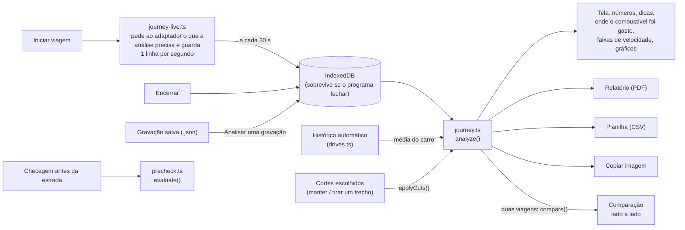

Os cortes ficam guardados junto com a viagem (o campo `cuts`), sem apagar as linhas originais: desfazer é só esvaziar a lista. A checagem antes da estrada pede ao adaptador, por uns segundos, rotação, temperatura e tensão (`state.extraKeys` em `store.ts`), lê os códigos de falha e a prontidão e depois devolve a leitura como estava.

O programa grava, uma vez por segundo, só o que a análise usa: velocidade, rotação, carga, borboleta, temperatura, correções de combustível, malha fechada, etanol (flex) e o necessário para calcular o consumo (vazão, MAF ou MAP). O consumo de cada linha é o mesmo do computador de bordo, já com a calibração do posto. Um intervalo de mais de 5 segundos sem dados (programa fechado, conexão caída) fica fora da conta.

### Documentação dentro do programa

Os documentos do projeto (este arquivo incluído) entram no programa na hora de gerar o instalador, então abrem sem internet e sempre batem com a versão instalada. A tela **Documentação** mostra a lista, transforma o texto em página e desenha os diagramas com o Mermaid, que só é carregado quando um documento com diagrama é aberto, nas cores do tema escolhido. Os números da página inicial (quantos códigos de falha, fabricantes, parâmetros) vêm das próprias bases do programa, pelo comando `data_info`.

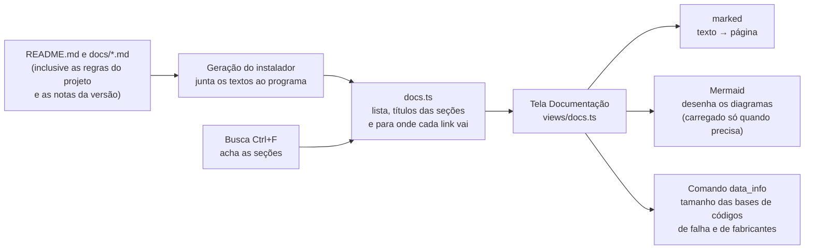

Links entre documentos abrem na própria tela; links para sites e para arquivos de código abrem no navegador (no GitHub). Um teste confere que todo link para uma seção de outro documento aponta para uma seção que existe.

### Quando a leitura ao vivo liga e desliga

Conectar não liga a leitura. Ela começa ao abrir o Painel ao vivo ou o HUD e continua ao trocar de tela, para os gráficos, o computador de bordo e a gravação seguirem recebendo dados. O botão **Pausar leitura** desliga; depois ele vira **Retomar leitura**, e o Painel e o HUD não religam sozinhos até você retomar ou conectar de novo. Quem decide é `autoStartReading` em `views/dashboard.ts`, com a marca `readingPaused` em `store.ts`.

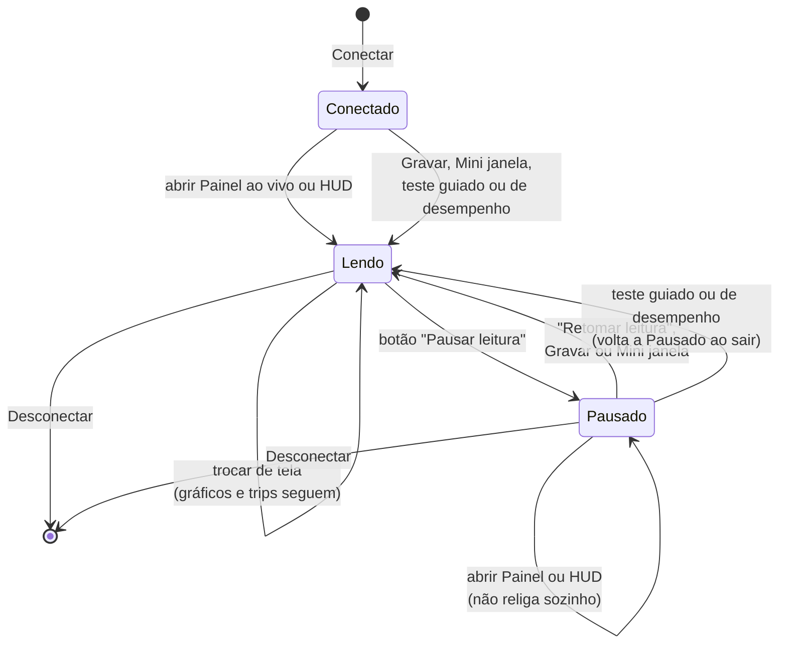

### Testes de desempenho: uma prova por vez

Na tela **Testes de desempenho** só a prova marcada em **Fazer esta prova** mede; as outras ficam apagadas. `perf.ts` acompanha a velocidade e reconhece sozinho o começo e o fim. A retomada (40–80, 80–120) só vale partindo de velocidade constante, como numa ultrapassagem de verdade.

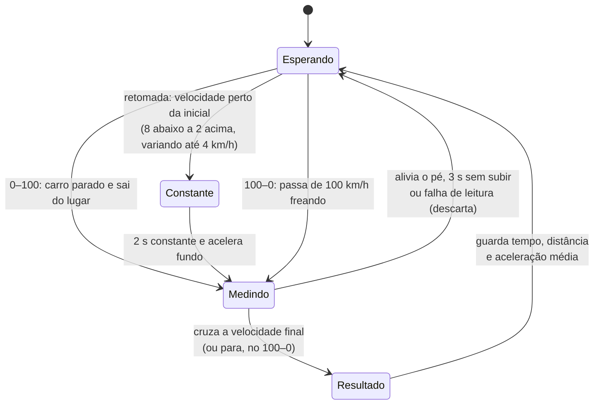

---

## 7. Perfis de veículos e unidades

Cada carro tem um perfil (combustível, cilindrada, alertas, resultados de desempenho). O programa reconhece o carro pelo chassi (VIN). As unidades só mudam o que aparece na tela: por dentro tudo continua no sistema métrico do OBD2.

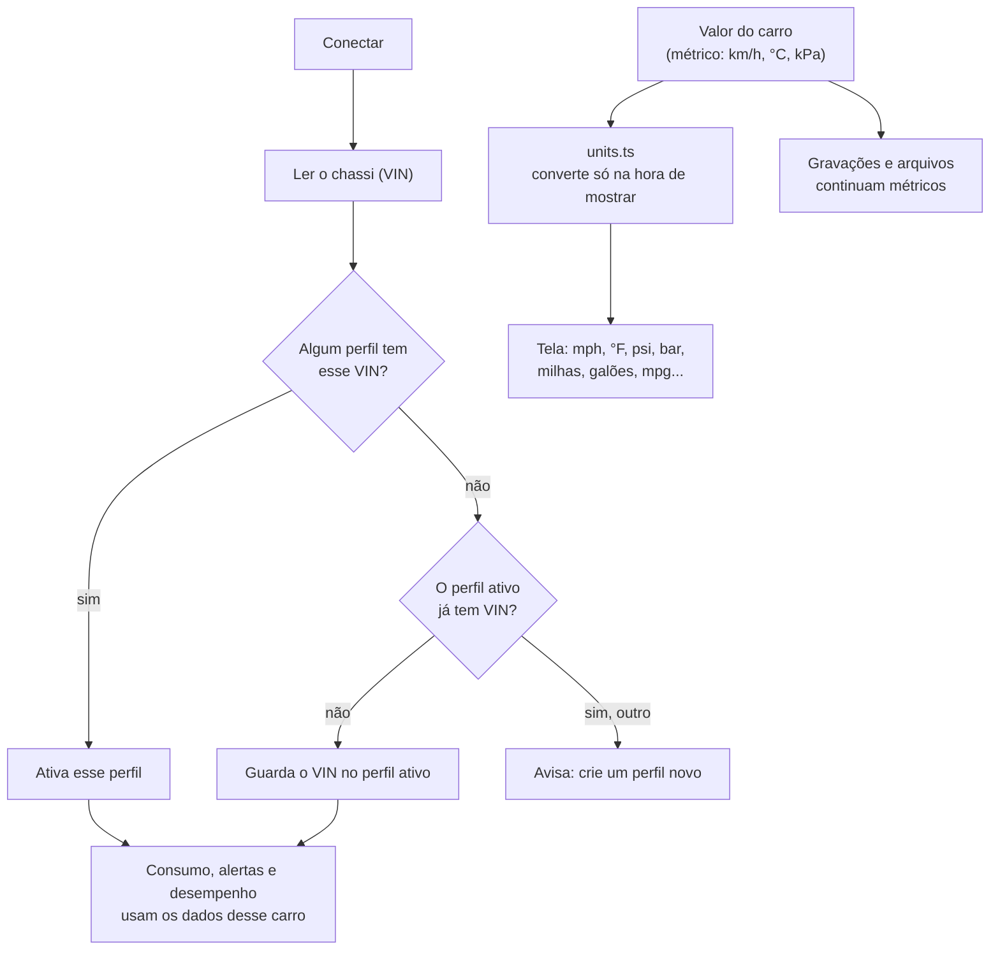

### Trocar o idioma troca as unidades

Escolher um idioma aplica as unidades usuais dele e redesenha todas as telas na hora. Os textos são escritos com valores métricos ("abaixo de 60 °C"); na hora de mostrar, `units.ts` converte esses números para as unidades escolhidas. O inglês da Europa (en-GB) não é um arquivo traduzido à parte: ele é gerado do inglês dos EUA trocando a grafia americana pela britânica (gasoline → petrol, liter → litre).

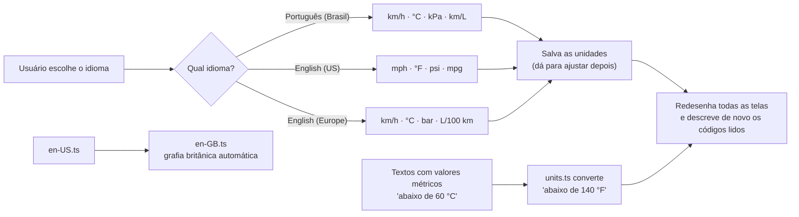

### Como o consumo é calculado e o ajuste pelo abastecimento

Ao conectar, o programa vê quais sensores o carro informa e guarda no perfil qual conta ele usa (linha **Consumo calculado por**). A cilindrada e a eficiência volumétrica só aparecem quando a conta é pelo MAP, porque só ali entram. O ajuste pelo abastecimento compara os litros da bomba com os calculados: em carros só com MAP corrige a eficiência volumétrica; em carros com MAF (dentro de **Avançado**) corrige um fator geral, útil com o sensor sujo ou velho. Quem faz as contas é `refuel.ts`; `trip.ts` soma os litros e aplica a correção.

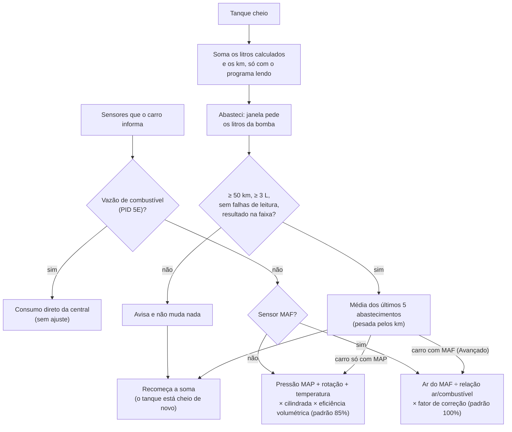

---

## 8. Onde os dados ficam guardados

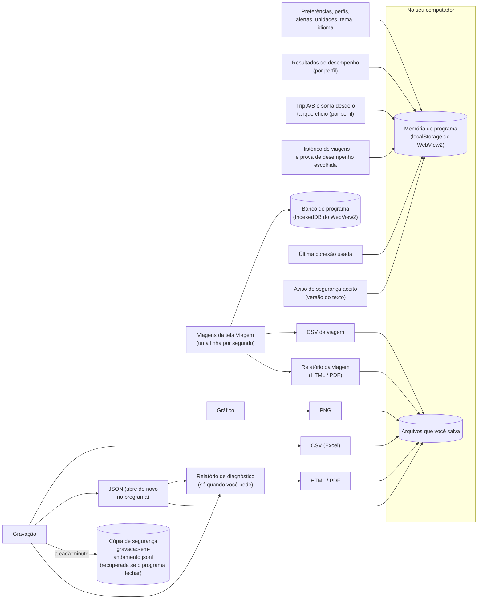

### Gravação e relatório

Ao gravar, o programa guarda os parâmetros lidos (os do painel e os escolhidos a mais nos gráficos) e, junto, uma "foto" do diagnóstico: no começo, os dados do carro, os códigos de falha com o quadro congelado, a prontidão e o Modo 06; no fim, os códigos e a prontidão de novo (um código pode aparecer no meio do trajeto). Tudo isso é só leitura. O relatório é gerado depois, apenas se você pedir, a partir da última gravação ou de um arquivo JSON salvo.

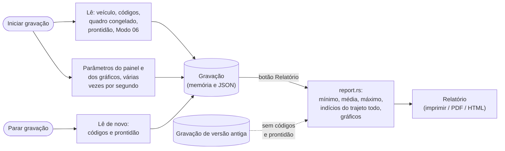

Na **versão portátil** (arquivo `portable.txt` ao lado do programa), a memória do programa fica na pasta `OBD2-Scanner-dados`, ao lado do `.exe`, em vez da pasta do usuário no Windows:

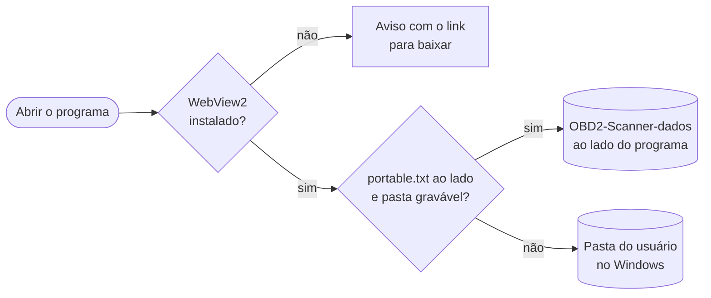

Nada é enviado para a internet.

---

## 9. Verificação automática (CI)

A cada envio para o GitHub, dois computadores do GitHub testam o programa e montam o instalador. Uma etiqueta de versão (tag `v1.0.0`) dispara o fluxo de lançamento, que cria um rascunho na página de download; ele só aparece para todos depois que alguém clica em **Publish release**.

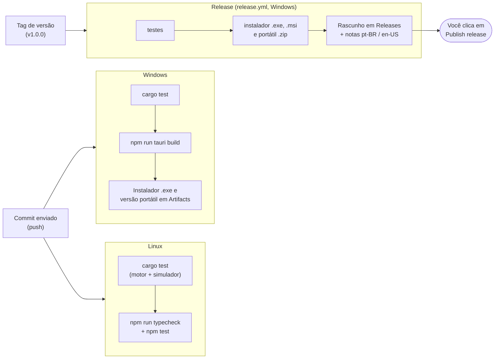
