# Visual map of the program

Diagrams of all the components of OBD2 Scanner, in plain language. GitHub draws the diagrams by itself when you open this file on the website (they are written in [Mermaid](https://mermaid.js.org), a text format for diagrams). In VS Code, install the **Markdown Preview Mermaid Support** extension and use `Ctrl+Shift+V` to see them.

> **Project rule:** whoever changes, creates or removes a component updates this file in the same commit (and its Portuguese original, `docs/DIAGRAMAS.md`).

Contents: [1. Overview](#1-overview) · [2. From the car to the screen](#2-from-the-car-to-the-screen) · [3. Ways to connect](#3-ways-to-connect) · [4. Engine (obd-core)](#4-engine-obd-core) · [5. Connection health](#5-connection-health-freezes-and-reconnection) · [6. Screens and interface modules](#6-screens-and-interface-modules) · [7. Profiles and units](#7-vehicle-profiles-and-units) · [8. Where the data is stored](#8-where-the-data-is-stored) · [9. Automatic checks (CI)](#9-automatic-checks-ci)

---

## 1. Overview

The program has three floors. At the bottom, the **engine** (Rust) knows how to talk to the adapter and understand the car's answers. In the middle, the **shell** (Tauri) turns the engine into a Windows program and carries messages between the floors. On top, the **interface** (the screens) shows everything to you.

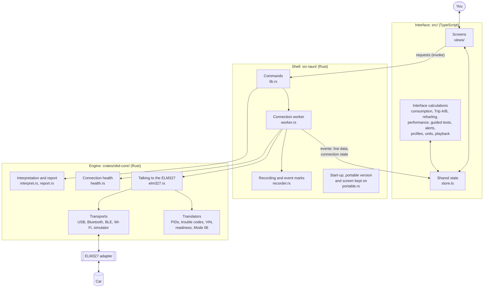

---

## 2. From the car to the screen

The path of **one live value** (for example, the engine RPM), several times per second.

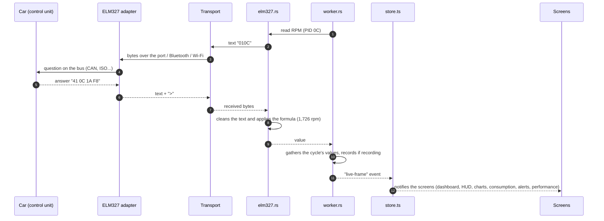

---

## 3. Ways to connect

All connections follow the same rule (the `Transport` interface): just carry bytes from one side to the other. That is why the rest of the program does not need to know which one is in use.

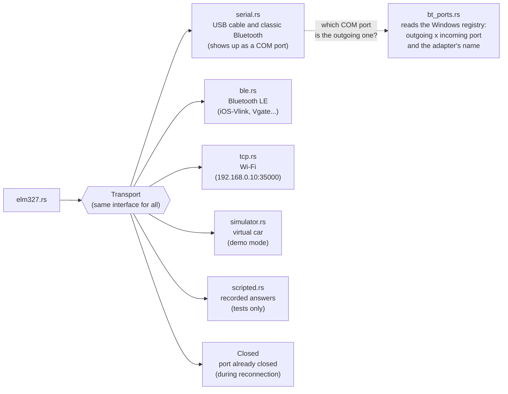

---

## 4. Engine (obd-core)

The engine has no screens. It can be tested on its own (`cargo test`) and reused in another program.

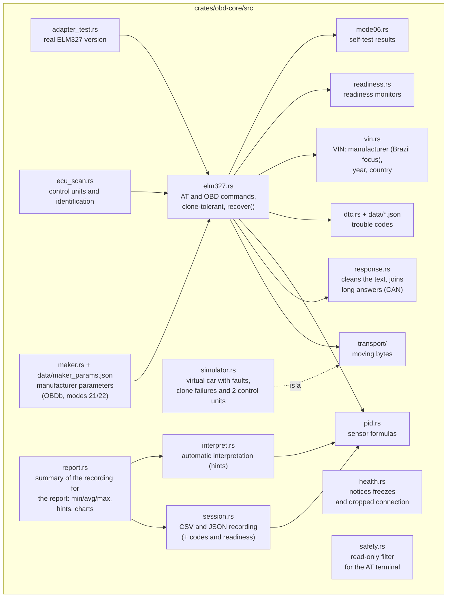

### Diagnostic tools for the adapter and the car

Both tests change the adapter's settings for a few seconds and always end with a restart (`ATZ`) and the configuration put back. Neither of them writes anything to the adapter or to the car's control unit.

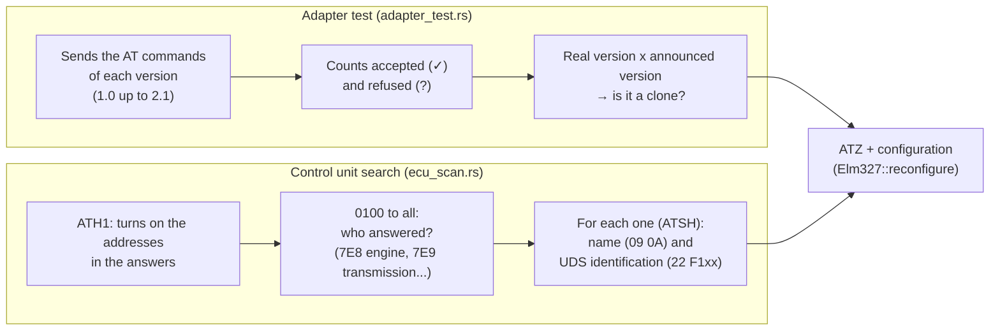

### Manufacturer parameters (pilot)

Besides the standard parameters, which hold for any car, some models have the carmaker's own readings (oil temperature, gear engaged, transmission temperature...). Each model's table comes from the open OBDb project and is kept inside the program (`data/maker_params.json`, generated by `tools/obdb_import.py`). The request goes to a single control unit, and then the adapter goes back to normal mode, where the request goes to all of them.

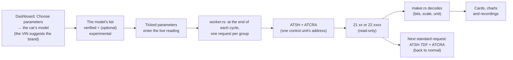

What the program imports from OBDb is read-only: 21 or 22 requests straight to a control unit. Requests that require opening a diagnostic session in the control unit are left out. A "verified" parameter was confirmed on a real car (sometimes from another country); the "experimental" ones stay hidden until the user asks.

### Read-only: what never leaves the program

The program only reads the car. The AT terminal is the only place where a free command is typed, so every line goes through `safety.rs` before going to the adapter, and goes exactly as it was checked: with no spaces, line breaks or invisible characters, so a line never carries a hidden second command. Clearing codes has its own button, which asks for confirmation and checks on the spot that the engine is stopped.

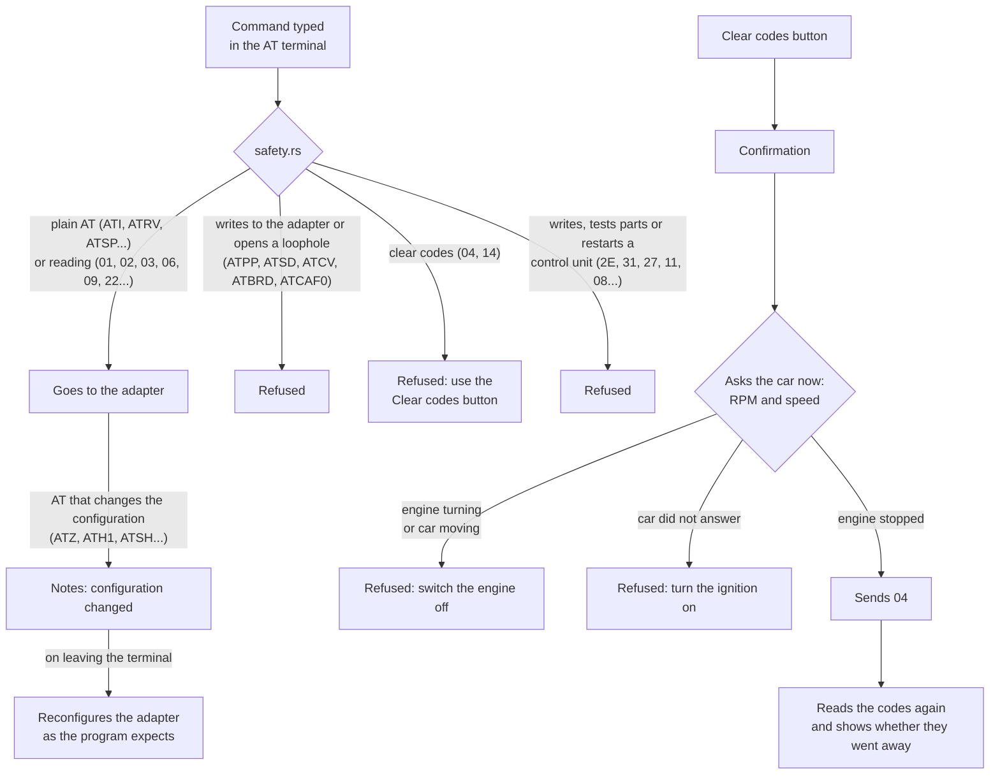

Commands like `ATZ` (restart) or `ATH1` (show headers) change the way the adapter answers, and the live dashboard would not understand the answers. So, when leaving the Terminal, the program reconfigures the adapter the same way it does after a reconnection, on the protocol already found and without the slow search.

---

## 5. Connection health: freezes and reconnection

Clone adapters sometimes freeze, restart by themselves on a voltage drop (when the engine starts) or lose Bluetooth. The connection worker (`worker.rs`) watches every answer with the help of `health.rs` and reacts by itself. The screen shows a yellow bar while this happens.

```mermaid
stateDiagram-v2
    [*] --> Normal
    Normal --> Normal: valid answer or "NO DATA"
    Normal --> Suspicious: silence, STOPPED,<br/>BUFFER FULL, garbage
    Suspicious --> Normal: answering again
    Suspicious --> Recovering: 3 requests in a row with no answer
    Normal --> Recovering: adapter restarted by itself<br/>("ELM327 v..." or "LV RESET" appeared)
    Recovering --> Normal: ATI answers, ATZ + configuration,<br/>same protocol as before
    Recovering --> CarSilent: adapter ok,<br/>car does not answer
    CarSilent --> Normal: tries again in 5 s
    Recovering --> Reconnecting: adapter does not even answer ATI
    Normal --> Reconnecting: port dropped<br/>(Bluetooth out of range, cable)
    Reconnecting --> Normal: port reopened<br/>(waits 1, 2, 3, 5, 8, 10, 10... s;<br/>USB: also on the new COM)
    Reconnecting --> Disconnected: 3 minutes without success<br/>or you clicked "Stop"
    Disconnected --> [*]
```

If the adapter is USB and Windows changes the COM number after unplugging and plugging the cable, the reconnection finds the same adapter on the new port by the USB serial number.

With the adapter idle (no live reading), a silent `ATRV` every 10 s notices the drop early. In demo mode each failure can be provoked (Connection → "Simulate faulty clone adapter").

---

## 6. Screens and interface modules

Each screen is a file in `src/views/`. The calculation modules live in `src/` and work with the same live data, which is why they work the same with the car and with a recording played back.

```mermaid
flowchart LR
    subgraph telas["Screens (src/views/)"]
        connection["Connection<br/>+ adapter test"]
        dashboard["Live dashboard"]
        findings["Data interpretation<br/>box<br/>views/findings.ts"]
        refueldlg["Refueled window<br/>views/refuel-dialog.ts"]
        safetydlg["Safety notice<br/>when the program opens<br/>views/safety.ts"]
        hud["HUD"]
        journey["Trip<br/>Start/End, consumption<br/>analysis, report<br/>views/journey.ts"]
        performance["Performance tests<br/>(one test at a time)"]
        guided["Guided tests<br/>battery, sensors,<br/>trim map"]
        prepurchase["Pre-purchase check<br/>5-step assistant<br/>views/prepurchase.ts"]
        charts["Charts"]
        diagnostics["Trouble codes<br/>+ Mode 06"]
        vehicle["Vehicle & readiness<br/>+ control units"]
        terminal["AT terminal"]
        sessions["Recordings & reports"]
        glossary["Glossary"]
        docsview["Documentation<br/>guides, rules, diagrams,<br/>data and licenses"]
        settings["Settings"]
    end
    subgraph modulos["Modules (src/)"]
        store["store.ts<br/>state and notices"]
        api["api.ts<br/>bridge to Rust"]
        trip["trip.ts + trips.ts<br/>consumption, Trip A and Trip B"]
        refuel["refuel.ts<br/>calibration from refueling"]
        cost["cost.ts + fuels.ts<br/>fuels by region,<br/>cost and gasoline × ethanol"]
        perf["perf.ts<br/>0-100 detection etc."]
        battery["battery.ts<br/>steps and limits of the<br/>battery test"]
        o2test["o2test.ts<br/>sensors and catalytic converter"]
        trims["trims.ts<br/>fuel trim<br/>map"]
        ppmod["prepurchase.ts<br/>traffic light of each item,<br/>history and comparison"]
        ppreport["views/prepurchase-report.ts<br/>pre-purchase report"]
        m06hints["mode06hints.ts<br/>hints from the control unit<br/>tests (Mode 06)"]
        dtcadvice["dtcadvice.ts<br/>notice for a carmaker code<br/>with no reliable description"]
        makerts["maker.ts + views/maker-picker.ts<br/>car model and manufacturer<br/>parameters on the Dashboard"]
        alerts["alerts.ts<br/>alerts and beep"]
        playback["playback.ts<br/>playback"]
        prefs["prefs.ts<br/>preferences and profiles"]
        units["units.ts<br/>units"]
        gauge["gauge.ts<br/>dials"]
        theme["theme.ts<br/>themes and day/night button"]
        presets["presets.ts<br/>ready-made layouts and<br/>chart presets"]
        calc["calc.ts<br/>calculated parameters<br/>(consumption L/h and km/L)"]
        share["share.ts<br/>'Copy image' card"]
        warmup["warmup.ts<br/>engine cold / ready"]
        summary["summary.ts + drive-summary.ts<br/>summary when the engine stops"]
        drives["drives.ts + views/drive-history.ts<br/>trip history,<br/>gasoline × ethanol, monthly totals"]
        jlive["journey-live.ts<br/>records the trip<br/>(1 sample per second)"]
        janalyze["journey.ts<br/>analysis: where the fuel<br/>went, speed bands,<br/>driving style, tips"]
        jstore["journey-store.ts<br/>saved trips (IndexedDB)"]
        jreport["views/journey-report.ts<br/>screen numbers, report,<br/>CSV and image card"]
        precheck["precheck.ts<br/>pre-trip check:<br/>codes, light, battery/alternator,<br/>temperature"]
        search["search.ts + views/search.ts<br/>Ctrl+F / Ctrl+K search"]
        mini["views/mini.ts<br/>mini window on top of the others"]
        safety["safety.ts<br/>safety notice version<br/>and whether it was accepted"]
        recdiag["recording-diagnostics.ts<br/>reads codes, readiness and<br/>Mode 06 when recording"]
        reportview["views/report.ts<br/>builds the HTML report"]
        i18n["i18n.ts + locales/<br/>texts pt-BR, en-US and en-GB<br/>(English Europe)"]
        upresets["unit-presets.ts<br/>units of each language"]
        docsmod["docs.ts<br/>embedded documents<br/>(README and docs/*.md,<br/>in each language)"]
    end
    dashboard --> gauge & trip & alerts & presets & warmup & findings & makerts
    diagnostics --> dtcadvice
    settings --> safetydlg
    safetydlg --> safety
    reportview --> dtcadvice
    trip --> refuel
    dashboard --> refueldlg
    refueldlg --> refuel
    charts -- "chosen parameters<br/>are also read" --> store
    hud --> warmup & mini
    diagnostics & charts --> share
    charts --> presets & calc & trip
    store --> calc
    diagnostics --> m06hints
    dashboard --> summary
    summary --> trip & cost & share
    summary --> drives
    journey --> jlive & janalyze & jstore & jreport & drives & precheck
    jlive --> trip & jstore
    jlive -- "the trip's parameters<br/>are also read" --> store
    jreport --> cost & share & reportview
    search --> glossary & diagnostics & docsview
    docsview --> docsmod & safetydlg & glossary
    settings --> docsview
    performance --> perf
    guided --> battery & o2test & trims
    prepurchase --> ppmod & ppreport & recdiag
    ppmod --> battery & m06hints
    sessions --> playback
    dashboard & sessions --> recdiag
    sessions --> reportview
    settings --> prefs & units & theme
    connection --> prefs
    dashboard & hud & charts & performance --> units
    telas --> store
    telas --> api
    telas --> i18n
    units & prefs --> upresets
    trip & alerts --> prefs
    dashboard --> cost
    cost --> prefs
```

### Trip screen: from the Start button to the report

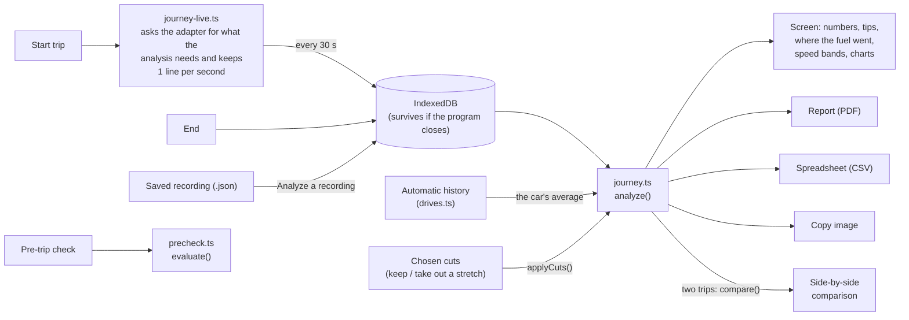

The cuts are saved together with the trip (the `cuts` field), without deleting the original lines: undoing is just emptying the list. The pre-trip check asks the adapter, for a few seconds, for RPM, temperature and voltage (`state.extraKeys` in `store.ts`), reads the trouble codes and readiness and then puts the reading back as it was.

The program records, once per second, only what the analysis uses: speed, RPM, load, throttle, temperature, fuel trims, closed loop, ethanol (flex) and what is needed to calculate consumption (flow rate, MAF or MAP). Each line's consumption is the same as the trip computer's, already with the calibration from the pump. A gap of more than 5 seconds without data (program closed, connection dropped) stays out of the calculation.

### Pre-purchase check: from the readings to the traffic light

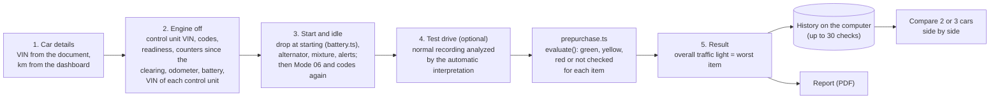

Each reading is optional: what the car does not answer becomes "Not checked" (gray), never green. The overall traffic light is the worst item found. For the VIN of each control unit, the control unit search (`ecu_scan.rs`) asks each one for its stored VIN (Mode 09, PID 02). The counters and the odometer are read once by the `read_pids` command, without touching the live reading.

### Documentation inside the program

The project's documents (this file included) go into the program when the installer is built, so they open with no internet and always match the installed version. Each document exists in Portuguese (`docs/`) and in English (`docs/en/`); the screen picks the one for the program's language, and for English (Europe) it applies British spelling to the English text. The **Documentation** screen shows the list, turns the text into a page and draws the diagrams with Mermaid, which is only loaded when a document with a diagram is opened, in the colors of the chosen theme. The numbers on the start page (how many trouble codes, manufacturers, parameters) come from the program's own databases, through the `data_info` command.

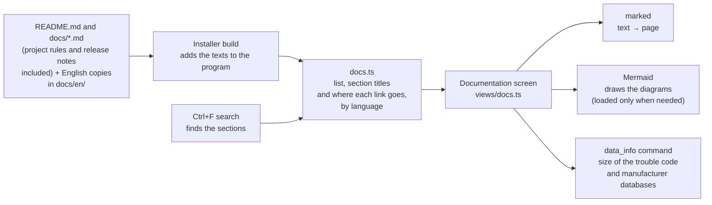

Links between documents open on the same screen; links to websites and to code files open in the browser (on GitHub). A test checks that every link to a section of another document points to a section that exists, and that the Portuguese and English documents have the same structure.

### When live reading turns on and off

Connecting does not turn reading on. It starts when you open the Live dashboard or the HUD and continues when you change screens, so the charts, the trip computer and the recording keep receiving data. The **Pause reading** button turns it off; after that it becomes **Resume reading**, and the Dashboard and the HUD do not turn it back on by themselves until you resume or connect again. What decides this is `autoStartReading` in `views/dashboard.ts`, with the `readingPaused` mark in `store.ts`.

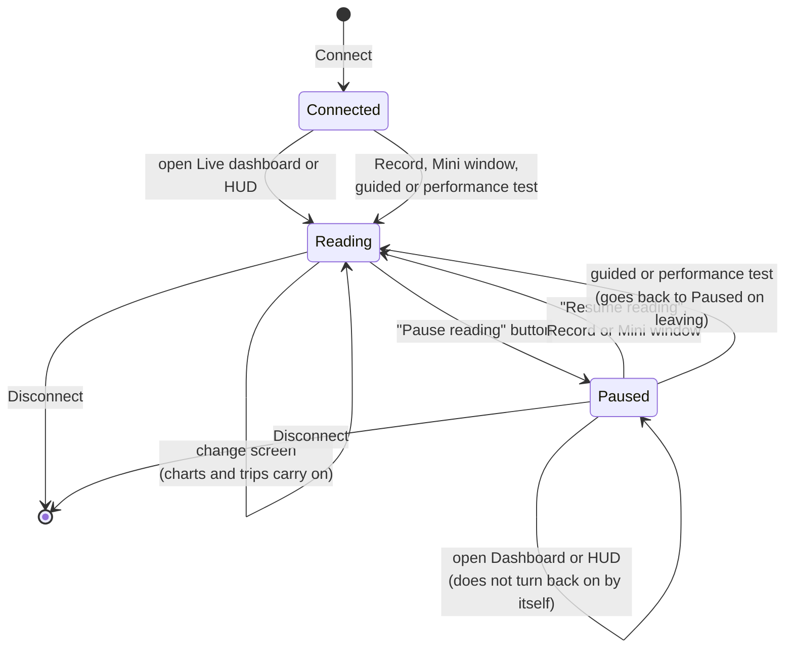

### Performance tests: one test at a time

On the **Performance tests** screen only the test ticked in **Do this test** measures; the others are grayed out. `perf.ts` follows the speed and recognizes the start and end by itself. The rolling test (40–80, 80–120) only counts when starting from a steady speed, like in a real passing maneuver.

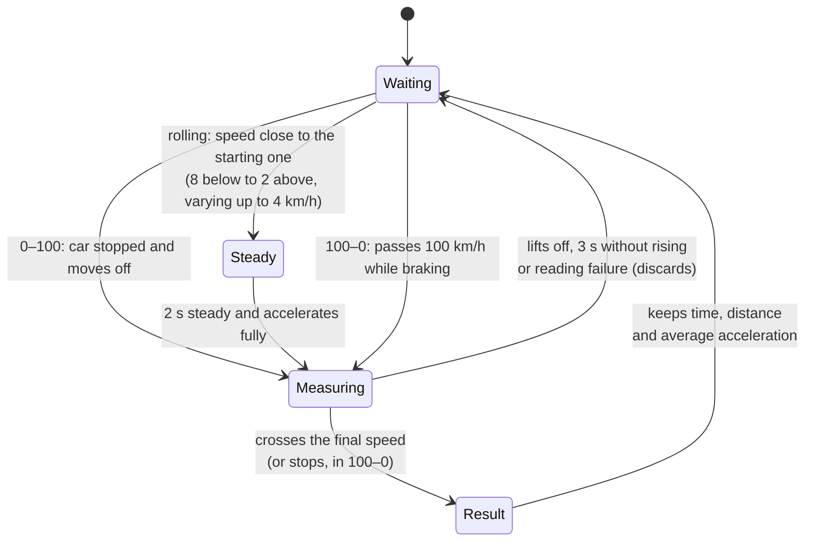

---

## 7. Vehicle profiles and units

Each car has a profile (fuel, engine size, alerts, performance results). The program recognizes the car by its VIN. The units only change what appears on the screen: inside, everything stays in the OBD2 metric system.

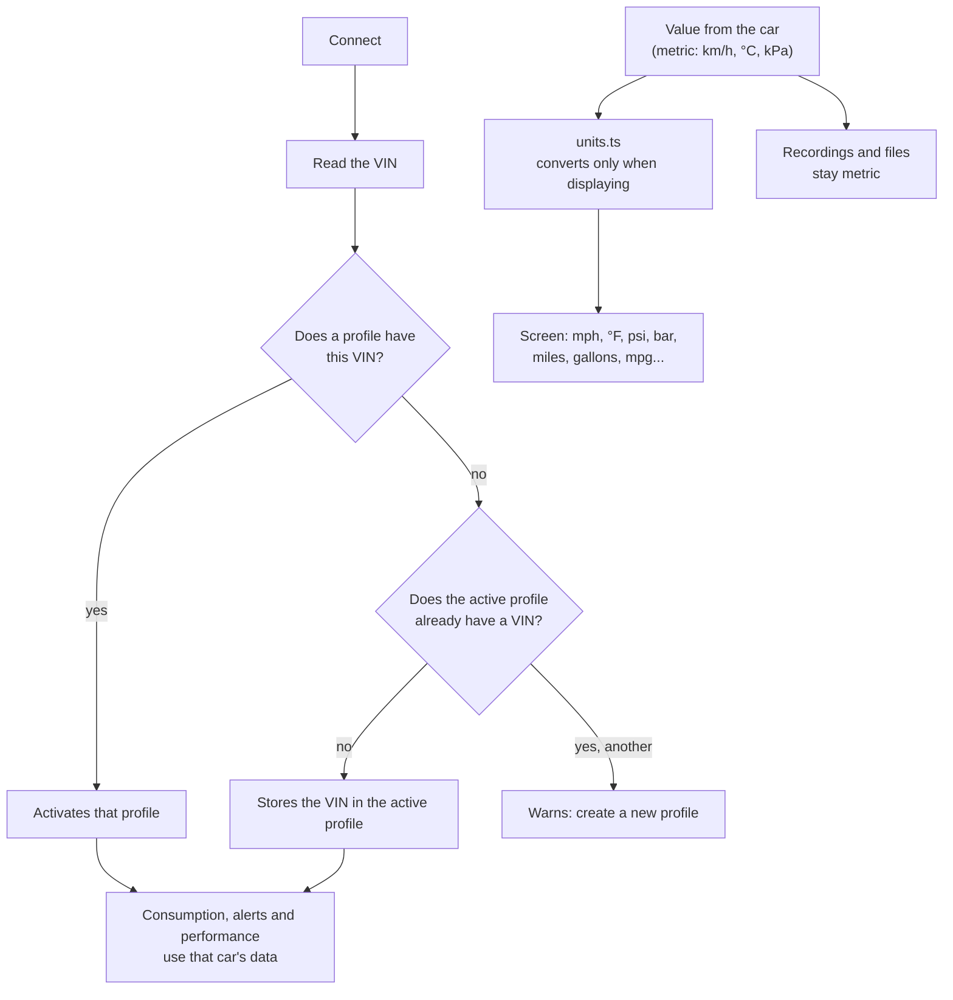

### Fuels by region

Each country sells different blends: in Brazil gasoline has 32% ethanol, in the USA and Europe almost always 10% (E10). This changes the consumption calculation, so the list of fuels follows the language (another region can be chosen in **Settings → Vehicles**). When it changes, each car moves to the same kind of fuel sold there; nothing is deleted.

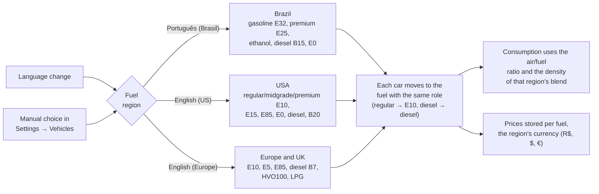

### Changing the language changes the units

Choosing a language applies its usual units and redraws all the screens at once. The texts are written with metric values ("below 60 °C"); when displaying, `units.ts` converts these numbers to the chosen units. European English (en-GB) is not a separately translated file: it is generated from US English by swapping American spelling for British (`gasoline` → `petrol`, `liter` → `litre`).

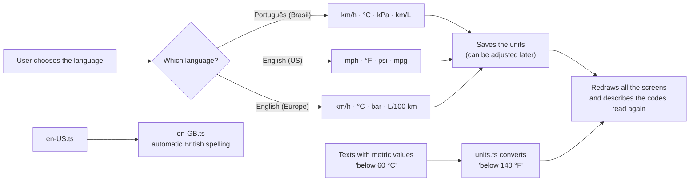

### How consumption is calculated and the calibration from refueling

When connecting, the program sees which sensors the car reports and stores in the profile which calculation it uses (the **Fuel use calculated from** line). The engine size and the volumetric efficiency only appear when the calculation is by MAP, because only there do they enter. The calibration from refueling compares the pump's liters with the calculated ones: on MAP-only cars it corrects the volumetric efficiency; on MAF cars (inside **Advanced**) it corrects an overall factor, useful with a dirty or old sensor. `refuel.ts` does the maths; `trip.ts` adds up the liters and applies the correction.

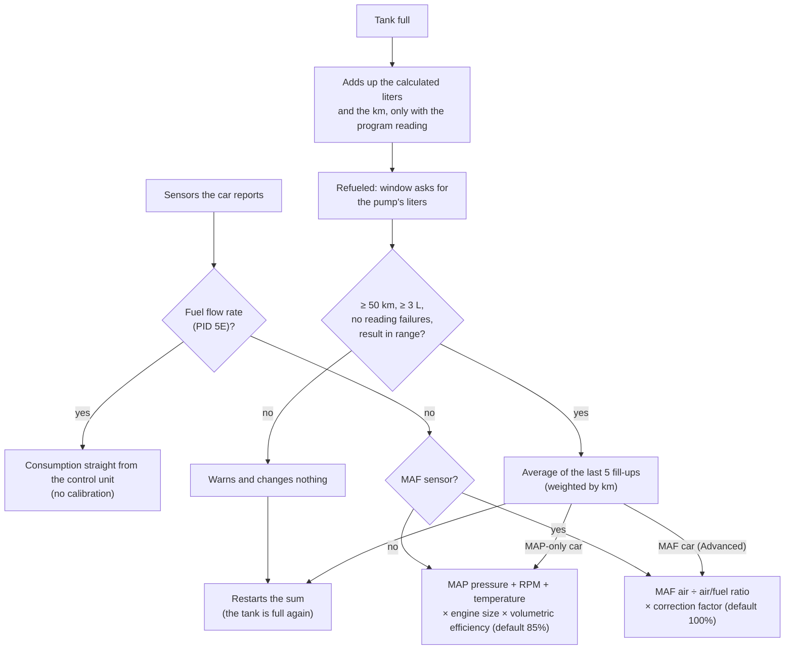

---

## 8. Where the data is stored

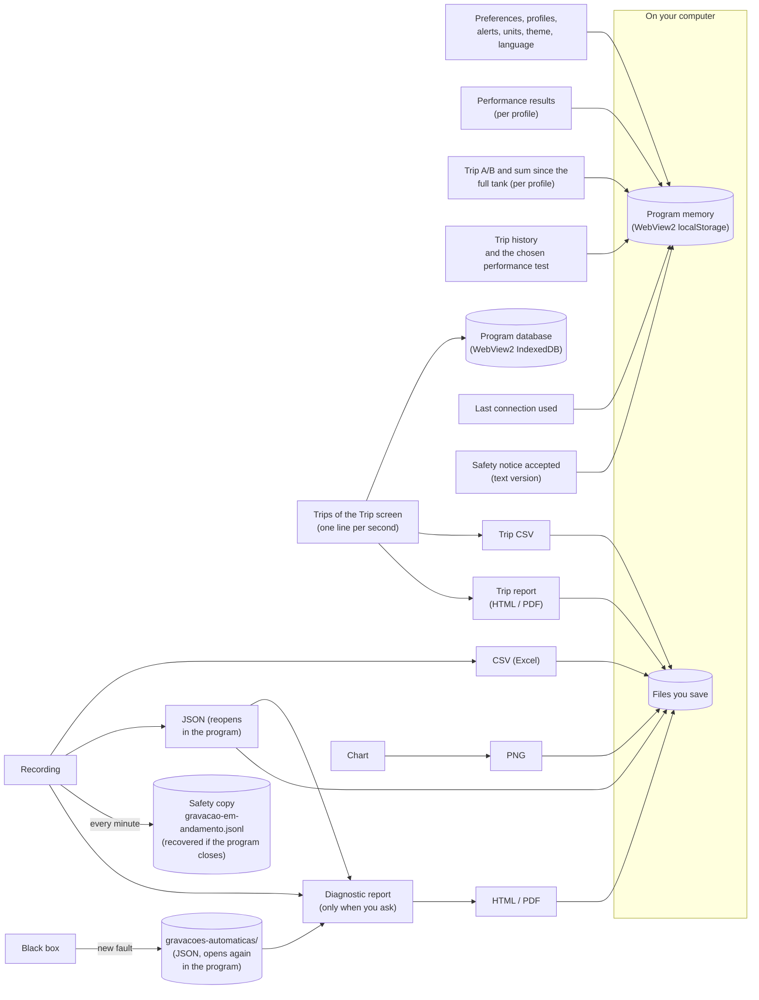

### Recording and report

When recording, the program keeps the parameters read (those of the dashboard and the extra ones chosen in the charts) and, along with them, a "photo" of the diagnosis: at the start, the car's data, the trouble codes with the freeze frame, readiness and Mode 06; at the end, the codes and readiness again (a code can appear in the middle of the trip). All of this is read-only. The report is generated afterwards, only if you ask, from the last recording or from a saved JSON file.

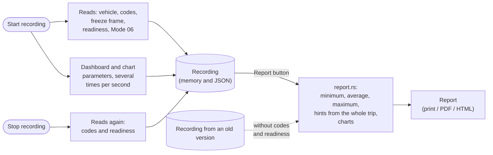

### Black box: automatic fault recording

While reading is on, the program keeps the last 2 minutes in memory. Every 5 seconds it asks the control unit whether the check-engine light turned on and, every 30 seconds, reads the pending codes. If a new fault shows up, it saves the 2 minutes before and the 2 minutes after by itself, with the codes and the freeze frame. Everything is read-only.

```mermaid
flowchart LR
    frames["Screen readings +<br/>~10 essential sensors"] --> mem[("Memory:<br/>last 2 min")]
    q1["Every 5 s: light on?<br/>how many codes? (01 01)"] --> watch{"New fault?<br/>(old codes<br/>do not count)"}
    q2["Every 30 s: pending<br/>codes (07)"] --> watch
    alert["An alert went off<br/>(optional)"] --> watch
    btn(["Save last 2 min"]) --> clip
    watch -- yes --> lists["Reads codes (03, 07, 0A)<br/>and freeze frame (02)"]
    lists --> clip["Clip: 2 min before<br/>+ 2 min after<br/>(another fault stretches it,<br/>up to 10 min)"]
    mem --> clip
    lists -- "if you are recording" --> mine["Mark in your<br/>recording"]
    clip --> file[("gravacoes-automaticas/<br/>up to 30 files or 200 MB<br/>(pinned ones stay)")]
    file --> screen["Recordings and reports:<br/>play back, charts,<br/>report, pin, delete"]
```

In the **portable version** (a `portable.txt` file next to the program), the program's memory stays in the `OBD2-Scanner-dados` folder, next to the `.exe`, instead of the user folder in Windows:

```mermaid
flowchart LR
    start(["Open the program"]) --> wv{"WebView2<br/>installed?"}
    wv -- no --> msg["Notice with the link<br/>to download it"]
    wv -- yes --> mk{"portable.txt next to it<br/>and folder writable?"}
    mk -- yes --> here[("OBD2-Scanner-dados<br/>next to the program")]
    mk -- no --> win[("User folder<br/>in Windows")]
```

Nothing is sent to the internet.

---

## 9. Automatic checks (CI)

On every push to GitHub, two GitHub computers test the program and build the installer. A version tag (tag `v1.0.0`) triggers the release workflow, which creates a draft on the download page; it only shows to everyone after someone clicks **Publish release**.

```mermaid
flowchart LR
    push["Commit sent<br/>(push)"] --> linux & windows
    subgraph linux["Linux"]
        core["cargo test<br/>(engine + simulator)"] --> ts["npm run typecheck<br/>+ npm test"]
    end
    subgraph windows["Windows"]
        wtest["cargo test"] --> build["npm run tauri build"] --> nsis["Installer .exe and<br/>portable version in Artifacts"]
    end
    tag["Version tag<br/>(v1.0.0)"] --> rel
    subgraph rel["Release (release.yml, Windows)"]
        rtest["tests"] --> rbuild["installer .exe, .msi<br/>and portable .zip"] --> draft["Draft in Releases<br/>+ notes pt-BR / en-US"]
    end
    draft --> pub(["You click<br/>Publish release"])
```
